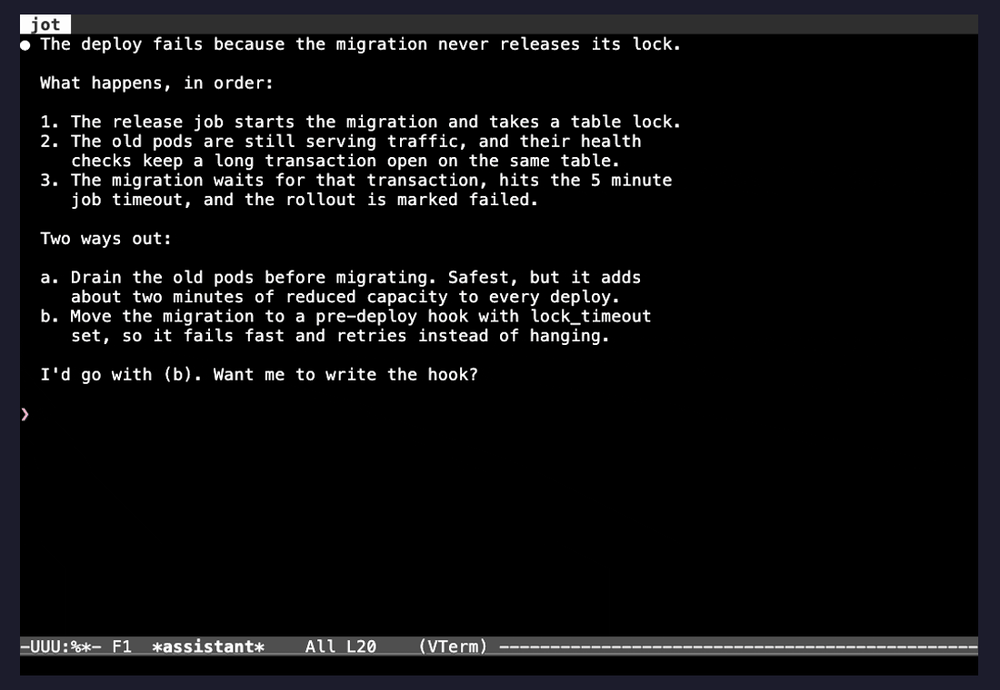

# jot

[](https://github.com/AAlvz/jot/actions/workflows/test.yml)

A pop-up notepad for Emacs, for taking notes while you read.

You are reading long output — an AI assistant's answer, a build log, a diff —
and want to note things about several parts of it. Jot pops a small notepad up
right under the line you are on, like a sticky note, with that line already
quoted. Type your note, press the key again, and you are back exactly where you
were. Notes pile up as you go, and when you are done reading, one key pastes
them all.

It was built for terminals inside Emacs, and it works from **vterm's copy
mode**: no toggling in and out of copy mode for every note.



## Contents

- [How it works](#how-it-works)
- [Install](#install)
- [Configuration](#configuration)
- [The pop-up](#the-pop-up)
- [Asking questions](#asking-questions)
- [Terminals](#terminals)
- [Development](#development)

## How it works

| Key (suggested) | Command | What it does |
|---|---|---|
| `C-c j` | `jot-toggle` | Pop the notepad up, quoting the line at point, or the region (a rectangle from `C-x SPC` quotes just its columns). Again: hide it and go back |
| `C-u C-c j` | `jot-toggle` | Pop it up without quoting anything |
| `C-c C-c` | `jot-hide` | In the notepad: hide it and go back |
| `C-c J` | `jot-paste` | Paste every note at point, then clear the notepad |
| `C-u C-c J` | `jot-paste` | Paste, but keep the notes |
| | `jot-clear` | Empty the notepad (its contents go to the kill ring) |

A session looks like this:

1. Read. In a vterm, enter copy mode (`C-c C-t`) and move around as usual.
2. `C-c j` on a line worth a note. The notepad pops up below it with
   `> the line` already in it. Type.
3. `C-c j` again. You are back on the same line, still in copy mode.
4. Repeat as often as you like. Notes accumulate.
5. `C-c J` at the prompt. Every note arrives as one paste, ready to edit and
   send.

Details worth knowing:

- **Peeking is free.** Open and close without typing and nothing is left
  behind, not even the quote.
- **Nothing is lost.** Pasted or cleared notes also go on the kill ring, and
  the notepad is a plain file saved each time it hides, so notes survive a
  restart.
- **Quotes are cleaned up.** Surrounding whitespace and the box-drawing
  borders (`│┃║`) that terminal UIs draw are trimmed.

## Install

Jot needs Emacs 29.1 or later. The pop-up needs a graphical Emacs, or Emacs 31
or later in a terminal; elsewhere jot uses a side window instead, with no
configuration needed. vterm is optional.

**Emacs 30 and later**, straight from GitHub:

```elisp
(use-package jot
  :vc (:url "https://github.com/AAlvz/jot" :rev :newest)
  :bind (("C-c j" . jot-toggle)
         ("C-c J" . jot-paste)))
```

**Emacs 29** has no `:vc` keyword. Install once with
`M-x package-vc-install RET https://github.com/AAlvz/jot RET`, then:

```elisp
(use-package jot
  :bind (("C-c j" . jot-toggle)
         ("C-c J" . jot-paste)))
```

**By hand:** put `jot.el` on your `load-path`, `(require 'jot)`, and bind the
keys.

Jot binds no global keys itself, since `C-c` followed by a letter is reserved
for users. Any keys work; the ones above are only a suggestion.

## Configuration

Everything is available through `M-x customize-group RET jot`.

| Option | Default | |
|---|---|---|
| `jot-display` | `popup` | `popup` next to point, or `side` for a docked window |
| `jot-popup-width` | `60` | Pop-up width in columns, narrowed to fit the window |
| `jot-popup-height` | `8` | Pop-up height in lines, at most half the window |
| `jot-popup-max-height` | `20` | Lines the pop-up may grow to, to show an answer |
| `jot-popup` (face) | inherits `tooltip` | Pop-up background and text colors |
| `jot-window-side` | `bottom` | Side window position: `bottom`, `top`, `left`, `right` |
| `jot-window-size` | `0.3` | Side window size: a fraction of the frame, or lines/columns |
| `jot-file` | `~/.emacs.d/jot.md` | Where the notes live |
| `jot-quote-prefix` | `"> "` | Put before each quoted line |
| `jot-trim-regexp` | whitespace and `│┃║` | Trimmed from both ends of quoted lines |
| `jot-clear-after-paste` | `t` | Empty the notepad after pasting; `C-u` inverts it once |
| `jot-quote-predicates` | vterm check | Functions that can veto quoting the line at point |
| `jot-paste-functions` | vterm paste | Functions that paste into special buffers |

A fuller setup:

```elisp
(use-package jot
  :vc (:url "https://github.com/AAlvz/jot" :rev :newest)
  :bind (("C-c j" . jot-toggle)
         ("C-c J" . jot-paste))
  :custom
  (jot-popup-width 70)            ; a wider sticky note
  (jot-popup-height 10)
  (jot-file "~/Documents/jot.md") ; keep notes somewhere you back up
  :custom-face
  (jot-popup ((t :background "#3b3f4c" :foreground "#e6e6e6"))))
```

## The pop-up

`jot-toggle` opens the pop-up just below the line at point, or just above it
when there is no room below, always inside the window you are reading.

It is not a separate scratch area: it shows the **whole notepad**, opened on
the newest note. Scroll up or search (`C-r`) inside it to reach earlier notes.

It is an Emacs *child frame*: a small frame floating over the main one, the
same mechanism completion pop-ups such as Corfu use. Graphical Emacs has
always had them; Emacs 31 added them to text terminals, which is what makes
jot's pop-up work in `emacs -nw`. When they are not available, or with
`jot-display` set to `side`, the notepad opens in a side window instead and
works the same way.

The pop-up takes its colors from the `jot-popup` face, which inherits from
`tooltip`. If it blends in with your theme, give it a background of its own
(see the setup above), or run `M-x customize-face RET jot-popup RET`.

## Asking questions

Any note can be sent to an AI as a question. The answer is written into the
notepad right under it, and a follow-up written under the answer continues the
same conversation. By default it uses [Claude Code](https://claude.com/claude-code)
in print mode (`claude -p`), so it uses your existing `claude` login and no
API key is needed.

```
> The migration takes an ACCESS EXCLUSIVE lock, so set lock_timeout
? why would it queue? one sentence
= ALTER TABLE waits for every running transaction on the table to finish,
  and while it waits, every new query on that table queues behind it.
? and how long should lock_timeout be?
```

Setup:

```elisp
(use-package jot-ask
  :bind ("C-c a" . jot-ask))
```

| Key | Where | Does |
|---|---|---|
| `C-c a` (suggested) | anywhere | Pop up with the line or region quoted and a `? ` line ready |
| `C-u C-c a` | anywhere | The same, asking in the other mode |
| `C-c C-a` | in the notepad | Send the note being written as a question |
| `C-c C-p` | in the notepad | Switch the next question between quick and project |
| `C-c C-d` | in the notepad | Choose the project directory for the buffer being read |

The notepad's top line always shows the mode and these keys, and the pop-up
changes color while you ask: gray for notes, blue for a quick question, green
for a project question.

Once sent, the entry shows `= ⠋ sent · answer in 5`, counting down. It never
reaches zero: if the answer takes longer, it keeps going as 0.1, 0.01, 0.001…
until the answer replaces it. Nothing waits on it either: close the notepad and
keep reading, and the answer is written in when it arrives. Sending again
while an entry is still waiting is refused, and an answer that never comes
turns into an error after `jot-ask-timeout`.

### Quick and project questions

| | Quick | Project |
|---|---|---|
| Asked from | a clean folder, `~/.emacs.d/jot-ask/` | the project of the buffer being read |
| Knows | the quote and your question | that project's `CLAUDE.md`, and can read its files |
| Tools | none | read-only: `Read`, `Grep`, `Glob` |
| Typical answer | 4–5 seconds | a few seconds more, longer if it reads files |

`jot-ask-default-mode` picks the default. A question never reaches your MCP
servers or connectors, and a project question can read the project but never
run commands or change files.

Your own `~/.claude/CLAUDE.md` still applies in both modes. That is usually
what you want; an optional fully clean quick mode is tracked in
[#1](https://github.com/AAlvz/jot/issues/1). A `CLAUDE.md` placed in the quick
folder applies to quick questions only.

In a terminal, "the project" comes from where the terminal's program is
actually running, which the operating system knows: the shell at its prompt,
or whatever runs in it, such as Claude Code. That works without any shell
setup, follows `cd` and handles tmux. Over ssh, questions go out quick.
`C-c C-d` overrides the guess.

### What is sent

Only the quote and what you typed in that entry. Never the screen, the rest of
the notepad, or the output around the highlight. Terminal output can contain
tokens or internal names, so look at what you quote before asking.

### Options

| Option | Default | |
|---|---|---|
| `jot-ask-default-mode` | `quick` | `quick` or `project` |
| `jot-ask-model` | `nil` | A `claude --model` value; `nil` uses your usual model |
| `jot-ask-instructions` | short plain-text answers | Sent with every question |
| `jot-ask-quick-directory` | `~/.emacs.d/jot-ask/` | Where quick questions run |
| `jot-ask-project-tools` | `Read,Grep,Glob` | What project questions may use |
| `jot-ask-program` | `claude` | The Claude Code executable |
| `jot-ask-command-function` | `jot-ask-claude-command` | Build the command for another CLI |
| `jot-ask-expected-seconds` | `5` | Where the countdown starts |
| `jot-ask-timeout` | `180` | Seconds before giving up on an answer |
| `jot-popup-ask`, `jot-popup-ask-project` (faces) | blue, green | The pop-up's colors while asking |
| `jot-paste-answers` | `t` | `nil` leaves answers out of `C-c J` |
| `jot-show-hints` | `t` | The key line at the top of the notepad |
| `jot-question-prefix`, `jot-answer-prefix` | `"? "`, `"= "` | How questions and answers are marked |

Every question is a single, standalone call. A follow-up is sent with the
entry's quote and its earlier questions and answers, which is how it continues
the conversation. To use another command-line tool, set
`jot-ask-command-function` to a function that takes the prompt and the mode
and returns the command to run. Its standard output is the answer.

## Terminals

In a vterm buffer, point means something only in `vterm-copy-mode`, so that
is when the line is quoted; in a live terminal point is just the prompt.
`jot-paste` leaves copy mode on its own and sends the notes as a single
*bracketed paste*, so programs such as Claude Code or your shell receive the
newlines as text instead of pressing Enter on each one.

Other terminals plug in through two hooks:

- `jot-quote-predicates`: return `no` when the line at point is not worth
  quoting.
- `jot-paste-functions`: called with the text; send it and return non-nil
  when you handle the paste.

For example, an `eat` terminal:

```elisp
(defun my/jot-eat-paste (text)
  (when (derived-mode-p 'eat-mode)
    (eat-term-send-string eat-terminal text)
    t))
(add-hook 'jot-paste-functions #'my/jot-eat-paste)
```

## Development

```
make compile     # byte-compile, warnings are errors
make lint        # checkdoc + package-lint
make test        # ERT suite
make test-vterm  # the suite plus a real vterm test, using your installed vterm
make demo        # re-record demo/jot.gif (needs vhs and gifsicle)
```

The demo in `demo/` is scripted with [VHS](https://github.com/charmbracelet/vhs)
in a throwaway Emacs and shell, so it can be re-recorded after any change.
Changes are listed in [CHANGELOG.md](CHANGELOG.md). Ideas and pull requests
are welcome.

## License

GPL-3.0-or-later. See [LICENSE](LICENSE).
